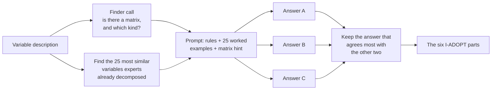

# i-adopt-llm-based-service

How well can language models describe scientific variables? This repository measures it, in two steps: taking a definition apart into the parts of the [I-ADOPT framework](https://w3id.org/iadopt/), and linking those parts to controlled vocabularies. The results go into the [I-ADOPT Variable Description Service](https://github.com/ArvinRastegar/iadopt-variable-description-service).

[](https://doi.org/10.5281/zenodo.18108687)

## Best pipeline so far

<!-- best-pipeline:start -->



| Pipeline | Close F1 |
|---|---:|
| Before: one fixed set of 25 examples | 0.590 |
| 25 most similar examples | 0.675 |
| + a first call that states the matrix | 0.684 |
| **Best so far: + three answers, keep the most typical** | **0.694** |

Same model (Qwen3.8-27B on PSNC), scorer and 102 variables. Each step's gain held when the variables were resampled: +0.08 for the similar examples, +0.016 for the matrix hint (measured on OpenRouter with the same model), +0.009 for keeping the most typical of three answers. The rows come from separate runs on PSNC. About 11 s per variable, and under 30 s for every variable measured. Exploratory: tuned on these 102 variables, so a new variable may score lower. Code: [`rag_tuning.py`](iadopt-lab/few-shot-selection/guided/rag_tuning.py) (the similar examples), [`answer_form_check.py`](iadopt-lab/few-shot-selection/guided/answer_form_check.py) (the matrix hint), [`fill_levers_test.py`](iadopt-lab/few-shot-selection/guided/fill_levers_test.py) (the three answers and the vote).

<!-- best-pipeline:end -->

## Highlights

- Compares 8 language models and several prompts on one benchmark of 102 scientific variables ([data](configuration-results.csv))
- The score doubles when the prompt shows 20 worked examples instead of none ([data](results/shot-count.csv))
- A method to choose the best examples, which does better than random choices on variables it has not seen ([report](iadopt-lab/few-shot-selection/example_selection/output/example-selection-report.md))
- Compares a chat model with a small reranker for linking ([runs](iadopt-linking/results))
- Built to be reproduced: a fixed scorer, stored prompts, answers and settings, campaigns that can be resumed, and more than 1,100 tests that run offline

## What is where

| Folder | What |
|---|---|
| [`iadopt-lab/`](iadopt-lab) | The decomposition experiments: prompts, providers, scorer, PostgreSQL store, campaigns, reports |
| [`iadopt-lab/few-shot-selection/`](iadopt-lab/few-shot-selection) | Studies on the examples in the prompt |
| [`iadopt-linking/`](iadopt-linking) | The linking experiments, with the answers of every run in `results/` |
| [`results/`](results) | The small tables behind the numbers on this page |
| [`configuration-results.csv`](configuration-results.csv) | One row per model configuration |
| `Expert-Assessment/` | Expert evaluations of the corpus and of model outputs, see the [note in the folder](Expert-Assessment/Corpus%20Analysis%20-%20readme.md) |
| `error_analysis/` | Analysis scripts |
| `misc/benchmarking_example/` | The first pipeline, which `error_analysis/` and the linking tests still use |

## Quick start

You need [uv](https://docs.astral.sh/uv/) and Python 3.12. The tests need no key and no database.

```bash
git clone https://github.com/ArvinRastegar/i-adopt-llm-based-service.git
cd i-adopt-llm-based-service/iadopt-lab
uv sync
uv run pytest -q -rs
uv run iadopt-lab verify
```

```bash
cd ../iadopt-linking
uv sync
uv run pytest -q
```

Tests that need a database are skipped without one. `verify` checks the corpus files. To ask a model you need a provider key, and the variable names are in `iadopt-lab/.env.example`.

## Reading the numbers

Scores are F1 over six fields. Numbers of different studies are not directly comparable, and the same model can score differently on different providers.

## Contributors

Arvin Rastegar, Barbara Magagna, Cristian Berrio Aroca, esgg and Saurav Kumar. The corpus is the work of the [I-ADOPT Corpus](https://github.com/i-adopt/Corpus) contributors.

## Licence

[MIT](LICENSE). The corpus files are CC BY 4.0 ([provenance](iadopt-lab/data/corpus/LICENSE-PROVENANCE.md), [notices](iadopt-lab/THIRD_PARTY_NOTICES.md)).
